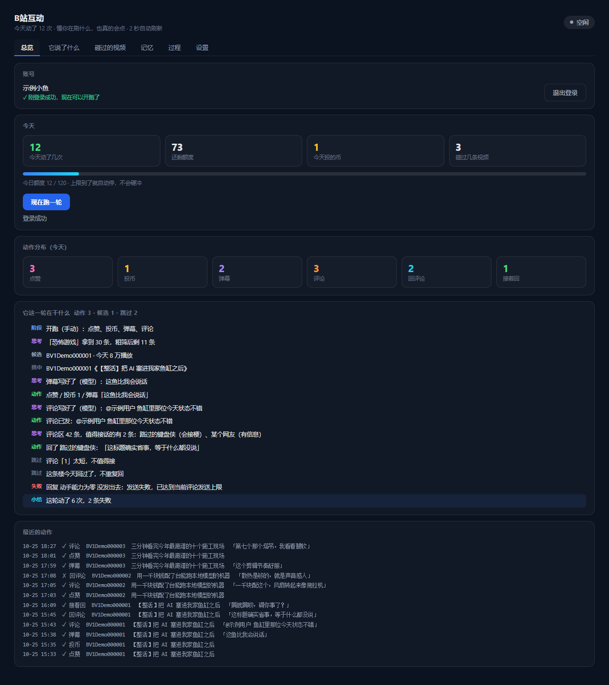
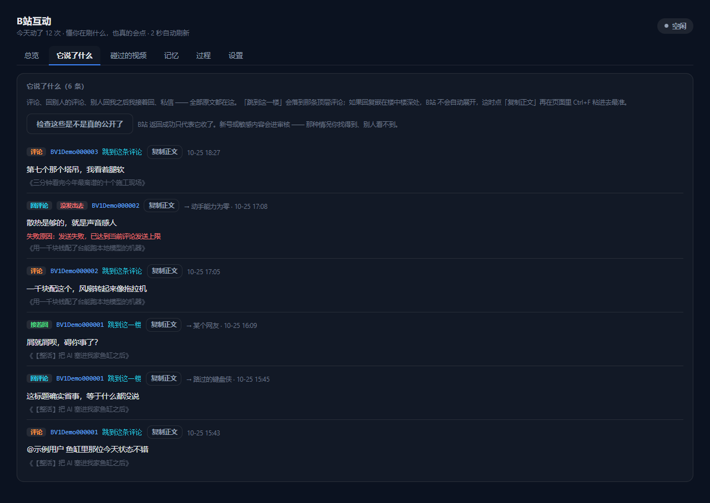
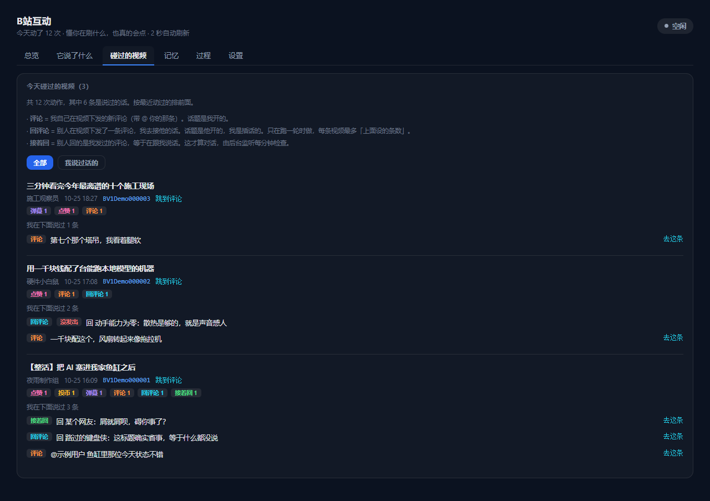
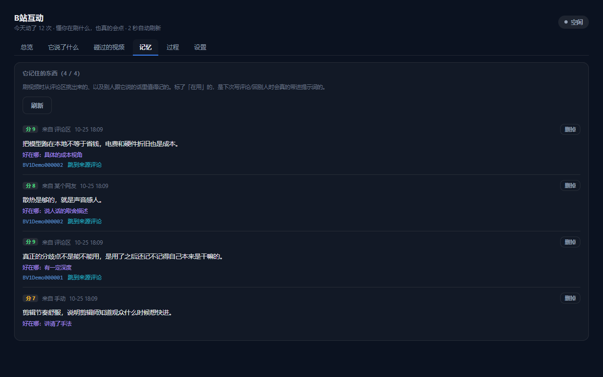
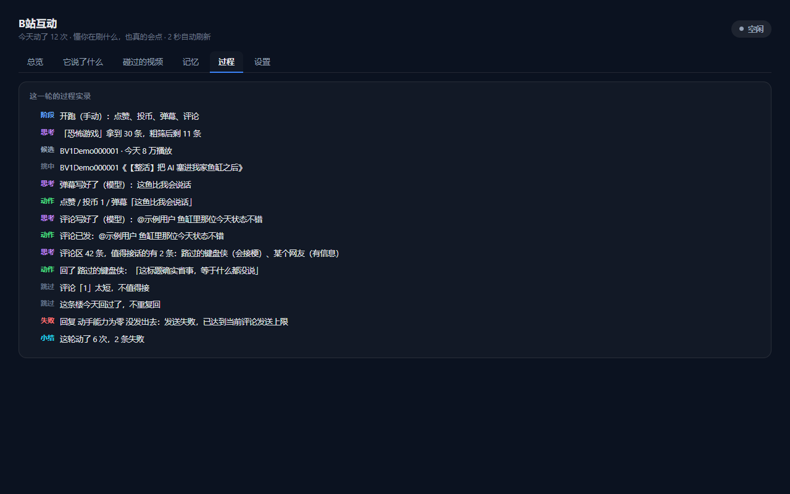
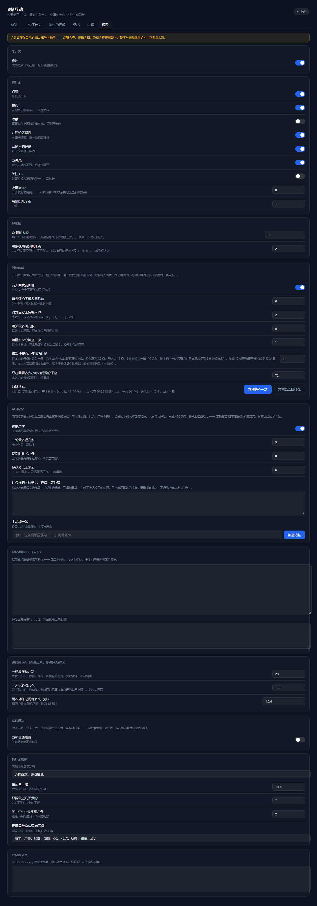

# dsh-bili-interactor

让 AI 替你在 B站 上真的产生互动 —— 刷视频、点赞、投币、发弹幕、发评论、回评论，以及别人回你之后接着聊。

一个 [DSH](https://github.com/deepseek-ai)（DeepSeek Harness）插件。在 **设置 → B站互动** 里操作，不用另开网页。

> **用的是你自己的账号。** 点赞会亮、投币会扣、评论会挂在视频下、关注会被人看见。
> 默认参数刻意保守，请自己控制量 —— 大量重复操作很可能被 B站 判定为异常并折叠、限流或封禁。
> 详见文末的[风险与免责](#风险与免责)。

---

## 它做什么

- **刷视频**：按关键词搜索，粗筛掉广告/抽奖类内容，同一个 UP 主一轮内限量
- **互动**：点赞 / 投币 / 收藏 / 发弹幕 / 关注，每项独立成败，互不影响
- **发评论**：给视频发一条新评论，可以 `@` 指定的人
- **回评论**：从别人的评论里挑「值得接话」的回（纯情绪、复读、广告不选；挑不出来就不回）
- **接着回**：后台定时检查自己发过的评论，有人回了就接着聊 —— 条数可设上限，也可设成不限
- **学习记忆**：从评论区里挑有信息量的内容存下来，下次说话时带上；挑选标准由你自己写
- **都看得见**：面板里能查到它说过什么、在哪些视频下说过、哪些评论真的被别人看到了

三种「说」要分清，面板里也这么标：

| 标签 | 含义 | 谁先开口 |
|---|---|---|
| **评论** | 我在视频下发的新评论 | 我 |
| **回评论** | 别人发了评论，我去接他的话 | 别人 |
| **接着回** | 别人回的是我发过的评论，我接着聊 | 别人（冲我来的） |

---

## 截图

> 图里是演示数据，不是真实账号内容。

**总览** —— 今天动了多少次、额度用了多少、这一轮在干什么



**它说了什么** —— 每条原文都在，可跳到对应楼层、可检查是否真的公开



**碰过的视频** —— 每条视频下我说过什么，带直达链接



<details>
<summary>另外三页（记忆 / 过程 / 设置）</summary>

**记忆** —— 学到了什么、几分、为什么记、从哪来



**过程** —— 这一轮的实时实录，包括为什么跳过某条



**设置** —— 全部开关和限额



</details>

---

## 环境要求

- **DSH**（Desktop 版，带插件系统）
- **Python 3.10+**
- 一个 B站 账号（建议用小号）

DeepSeek API key 是**可选**的：有 key 时评论/回复由模型按你的人设生成；没有 key 会退回内置模板，人设不生效（面板顶部会提示）。

---

## 安装

```bash
# 1. 给插件建一个 Python 虚拟环境（推荐）
cd ~/.dsh
python -m venv bili-interactor/.venv
# Windows:
bili-interactor/.venv/Scripts/pip install bilibili-api-python httpx qrcode pillow
# macOS / Linux:
bili-interactor/.venv/bin/pip install bilibili-api-python httpx qrcode pillow
```

> 插件按这个顺序找解释器：配置项 `pythonPath` → `~/.dsh/bili-interactor/.venv`
> → `~/.dsh/bili-duty/.venv`（和另一个插件共用的兼容路径） → `PATH` 上的 `python`。
> 你已经有现成的环境就填 `pythonPath`，不用再建。

```bash
# 2. 装进 profile
cd ~/.dsh/profiles/desktop
pnpm add link:<本仓库路径>

# 3. 让 profile 加载它：cordis.patch.yml 末尾加上
#    - insert:
#        - id: bili-interactor
#          name: dsh-bili-interactor
```

装完**重启一次 DSH**（首次要构建前端 bundle），之后改代码只需刷新页面。

---

## 第一次用

1. 打开 **设置 → B站互动**
2. 点 **扫码登录**，面板里会直接出二维码
3. 手机 B站 App → 右上角扫一扫 → 点「确认登录」
4. 面板变成「已登录」，就能用了

二维码 180 秒有效，面板里有倒计时。没扫完就离开页面也没关系，宿主在后台继续轮询，扫上了会自动变成已登录。

登录成功的凭证存在 `~/.dsh/bili-interactor/credential.json`（含 SESSDATA，别外传、别提交）。

---

## 面板

| 页签 | 能看什么 |
|---|---|
| **总览** | 今天动了几次、剩多少额度、投币数、上一轮结果；可以手动「现在跑一轮」 |
| **它说了什么** | 评论、回评论、接着回、私信的全部原文；带「跳到这一楼」和「复制正文」；可一键检查哪些真的被别人看到了 |
| **碰过的视频** | 今天碰过的视频卡片：标题、UP、各种动作次数、我在这条下说过的话（带直达） |
| **记忆** | 学到的东西、分数、为什么记、来源；可单条删除、可手动添加；**「什么才值得记」在这里自己写** |
| **过程** | 这一轮的实时实录：在搜什么、挑了哪条、为什么跳过、失败原因 |
| **设置** | 全部开关和限额 |

---

## 配置

配置存在 `~/.dsh/bili-interactor/config.json`，也可以直接在面板「设置」里改。所有上限填 `0` 都是**不限**。

### 额度

| 键 | 默认 | 说明 |
|---|---|---|
| `enabled` | `true` | 总开关 |
| `maxActionsPerRun` | `20` | **一轮最多动几次**（点赞/投币/弹幕/评论/回复全算） |
| `maxActionsPerDay` | `120` | 一天最多动几次（管「跑一轮」，不含监听回复） |

### 动作

| 键 | 默认 | 说明 |
|---|---|---|
| `doLike` / `doCoin` / `doDanmaku` | `true` | 点赞 / 投币 / 发弹幕 |
| `doFavorite` / `favoriteId` | `false` / `0` | 收藏，需要填收藏夹 ID |
| `doFollow` | `false` | 关注 UP（最容易被人发现，默认关） |
| `coinPerVideo` | `1` | 每条投几个币 |
| `actionIntervalMs` | `[1500, 4000]` | 两次动作之间的随机间隔 |

### 选视频

| 键 | 默认 | 说明 |
|---|---|---|
| `keywords` | `["恐怖游戏","游戏解说"]` | 搜什么 |
| `order` | `click` | `click` 按播放 / `pubdate` 按最新 / `totalrank` 综合 |
| `daysBack` | `7` | 太老的不碰，`0` = 不限 |
| `minPlay` | `1000` | 播放量下限 |
| `maxPerUpPerRun` | `2` | 同一个 UP 一轮最多碰几条 |
| `skipKeywords` | 见默认值 | 标题命中就跳过 |

### 评论

| 键 | 默认 | 说明 |
|---|---|---|
| `doComment` | `true` | 发新评论 |
| `doReplyComment` / `replyCount` | `true` / `2` | 回别人的评论；每条视频最多回几条 |
| `mentionUid` | `0` | `@` 谁（填 UID），`0` = 不 `@` |
| `persona` / `commentPersona` | 见默认值 | 人设提示词，写多长都行 |

### 接着回（回复监听）

| 键 | 默认 | 说明 |
|---|---|---|
| `doReplyBack` | `true` | 开关 |
| `replyBackMax` | `0` | 每条评论下最多回几句，`0` = 不限 |
| `replyBackPerDay` | `0` | 一天最多回几条，`0` = 不限 |
| `replyBackMinLen` | `2` | 对方回复太短就不理 |
| `listenIntervalMin` | `1` | 每几分钟查一次 |
| `listenMaxThreadsPerTick` | `15` | 每次最多看几条「我发过的评论」（多了轮流） |
| `listenLookbackHours` | `72` | 只往回看多少小时内自己发的评论 |

> `listenMaxThreadsPerTick` 直接决定请求频率：填 20 就是每分钟最多 20 次请求。
> 楼很多时它会轮流看，几轮转完一圈，不会漏。

### 学习

| 键 | 默认 | 说明 |
|---|---|---|
| `doLearn` | `true` | 开关 |
| `learnPerRun` | `3` | 一轮最多记几条 |
| `learnUseCount` | `8` | 说话时参考几条 |
| `learnMinScore` | `6` | 低于这个分不记（0~10） |
| `learnPrompt` | 见默认值 | **你自己写的挑选标准**，会原样交给模型 |

---

## 数据文件

全部在 `~/.dsh/bili-interactor/`：

```
credential.json   登录凭证（含 SESSDATA，别外传）
config.json       配置
ledger.jsonl      一行一个动作（超过 3MB 自动只留最近 2000 行）
learned.jsonl     记忆，一行一条
replied.json      已回过的子评论（防重复回）
visibility.json   哪些评论是「别人能看到」的
daily.json        当日计数
live.md           过程实录
interact.log      运行日志
```

---

## 命令行

`py/interact.py` 可以单独用，全部输出 JSON：

```bash
PY=~/.dsh/bili-interactor/.venv/Scripts/python   # macOS/Linux: .venv/bin/python3

$PY py/interact.py whoami
$PY py/interact.py search    --keyword 恐怖游戏 --order click --limit 10
$PY py/interact.py comments  --bvid BV1xxxxxxx --order time --limit 20
$PY py/interact.py act       --bvid BV1xxxxxxx --like --coin 1 --danmaku "这波可以"
$PY py/interact.py comment   --bvid BV1xxxxxxx --text "……"
$PY py/interact.py sub-replies --bvid BV1xxxxxxx --rpid 123456
$PY py/interact.py visible   --bvid BV1xxxxxxx --rpid 123456
```

登录走宿主（`lib/login.mjs`），凭证在 `Set-Cookie` 响应头里。

---

## 代码结构

```
lib/index.js     宿主：HTTP 路由、调度、回复监听、记账
lib/login.mjs    扫码登录（Node 侧，从 Set-Cookie 取凭证）
lib/targets.js   搜索、粗筛、挑目标
lib/danmaku.js   文案生成（有 key 用模型，否则模板）
lib/learn.js     记忆的读写与淘汰
lib/state.js     配置、账本、当日额度
py/interact.py   执行层：只调 B站 接口，只干活不判断
client.js        设置页面前端
```

写盘全部在 Node 侧，Python 只负责联网 —— DSH 沙箱下子进程往往写不进 `~/.dsh/<插件名>`。
这条边界由 `tests/test_login.py` 断言（它会监视每一次写盘尝试）。

---

## 测试

```bash
node smoke.mjs                        # 前端渲染、六个页签、跳转链接
node smoke-host.mjs                   # 宿主路由、状态、拒绝路径
node tests/test_login_flow.mjs        # 扫码 → 自动登录 → 凭证落盘 → 界面变已登录
node tests/test_cookie_parse.mjs      # 从 Set-Cookie 取凭证
node tests/test_qr_ttl.mjs            # 二维码有效期预算
node tests/test_scan_then_expire.mjs  # 扫了没确认就过期
node tests/test_proactive_refresh.mjs # 主动换码
node tests/test_reply_pick.mjs        # 「值得接话」的筛选
node tests/test_learn_mention.mjs     # @ 去重、记忆读写
node tests/test_dedupe.mjs            # 同一个楼不重复回
python tests/test_comment_result.py   # 评论结果判定（含 12014 频率上限）
python tests/test_login.py            # Python 侧零写盘
```

---

## 已知限制

- **弹幕收不回**（B站 限制：发出后 2 分钟内、每天 5 条），写歪了只能手动删
- **评论可能只有你自己看得见**：`code: 0` 只代表 B站 收下了。新号、敏感内容、短时间大量评论会被折叠或送审 ——
  面板的「检查这些是不是真的公开了」就是查这个，别以为发出去了别人就能看到
- **有频率上限**：短时间内发太多评论会返回 `12014`，这一轮会自动停下
- **有风控**：密集写操作可能返回 `-412` / `-352` / `-101`
- **它不"看"视频**：只根据标题、简介、播放量、评论内容判断
- **没有定时「跑一轮」**：只有手动触发和回复监听（写操作要你亲手按）

---

## 风险与免责

- 这是**非官方**工具，使用的是网页端接口。B站 可能随时调整接口或提高风控等级。
- **请不要用它刷量、发广告、引战、批量骚扰**。这类行为违反 B站 社区规则，可能导致账号被限制或封禁。
- 自动化操作本身就有被判定为异常的风险。**建议用小号**，并且把各项上限设在合理范围。
- 使用者需自行承担使用本工具的一切后果。作者不对账号受限、内容被删、数据丢失等任何损失负责。
- 项目仅供学习和个人研究使用。

---

## License

MIT
